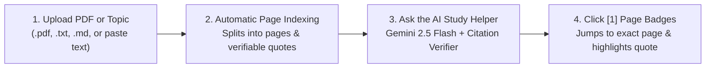

<div align="center">

# 📚 SOURCEWISE
### **Read Papers & Study Topics Easily — With AI That Proves Every Answer**

[](https://nextjs.org/)
[](https://react.dev/)
[](https://www.typescriptlang.org/)
[](https://tailwindcss.com/)
[](https://aistudio.google.com/)
[](https://vercel.com/)

<p align="center">
  <strong>An AI Study & Research Workspace for Students, Thesis Writers, and Curious Minds.</strong><br/>
  Upload any PDF or paste any study topic, read side-by-side with an AI tutor, and click numbered page badges <code>[1]</code> <code>[2]</code> to highlight the exact sentence on the real page.
</p>

</div>

---

## ✨ Why SOURCEWISE?

Normal AI chatbots often make up fake facts or fake quotes (*hallucinations*). **SOURCEWISE** is built around one strict rule: **Every AI answer must point to real words on a real page.**

- 📄 **Upload Real Files or Study Topics:** Upload `.pdf`, `.txt`, `.md`, or `.tex` files—or use the built-in **1-Click Starter Topics** (*🌋 Volcanoes & Earth Science*, *🧠 How Sleep Helps Memory*, *🤖 DeepSeek-R1 AI Reasoning*).
- 📖 **Split-Screen Reader + AI Study Helper:** Read your paper on the left while chatting with the AI on the right.
- 🎯 **Clickable Page Proof (`[1]`, `[2]`):** Click any numbered citation badge in the AI's answer to immediately jump to that exact page and highlight the proving quote in yellow.
- 🧠 **Visible AI Thinking Steps:** Expand *"🧠 How the AI Figured This Out"* on every answer to see how the AI searched your pages, verified quotes, and wrote its explanation.
- 📊 **Side-by-Side Compare Table:** Compare multiple papers across *Main Goal*, *How They Did It*, *Who / What Was Studied*, *Key Results*, and *Weaknesses*—and download the table as a `.md` report.
- 🗺️ **Interactive Visual Map & New Ideas Finder:** Explore how papers connect on an interactive node board, add your own custom idea boxes, and discover unanswered research gaps for your next essay or science project.
- ⚡ **Zero-Config Vercel Demo Ready:** Works immediately out of the box with a built-in **Smart Study Engine**, and upgrades seamlessly to live **Google Gemini 2.5 Flash** whenever an API key is provided.

---

## 🧭 How It Works (In 4 Simple Steps)



---

## 🛠️ Tech Stack & Design Architecture

| Layer | Technology | Purpose |
| :--- | :--- | :--- |
| **Framework** | Next.js 15.5 (App Router) + React 19 | Full-stack React framework & serverless API routes |
| **Styling & Tokens** | Tailwind CSS v4 + Custom Editorial Tokens | Warm Archival Paper (`#FBF9F5`), Deep Ink (`#181816`), Botanical Sage (`#3E5948`), Citation Amber (`#B45309`) |
| **Typography** | `Newsreader` + `Geist` + `Geist Mono` | Academic editorial serif headers paired with crisp UI sans and tabular citation badges |
| **AI & Grounding** | `@google/genai` (Gemini 2.5 Flash) + Custom Verifier | Multi-step evidence retrieval, thinking trace extraction, and 100% substring quote verification |
| **Document Parsing** | `pdf-parse` + Custom Sentence Chunker | Server-side PDF text extraction, metadata detection, and page-level offset indexing |
| **Database & Storage** | Supabase (PostgreSQL + RLS) + Serverless Local Sync | Ready for full Supabase persistence with automatic browser + serverless hydration for instant demos |
| **Testing** | Vitest + Testing Library | Unit tests for PDF chunking and strict citation verification |

---

## 🚀 Deploy to Vercel in 1 Minute

SOURCEWISE is pre-configured for **Vercel Serverless** (including `serverExternalPackages: ["pdf-parse"]` and automatic client-to-serverless state hydration for custom uploaded files).

1. Push or fork this repository to your GitHub account: **[github.com/akirausethis/SOURCEWISE](https://github.com/akirausethis/SOURCEWISE)**
2. Go to **[vercel.com/new](https://vercel.com/new)** and import `akirausethis/SOURCEWISE`.
3. **(Optional)** Add your free Google Gemini API key under **Environment Variables**:
   ```env
   GEMINI_API_KEY=AIzaSyYourKeyHere
   GEMINI_MODEL=gemini-2.5-flash
   ```
   > 💡 **Tip:** Don't have an environment variable set? No problem! Users can also paste their own Gemini API key directly inside the website under **`3. Settings & API Key`**, or use the built-in Smart Study Engine with zero setup.
4. Click **Deploy**! 🎉

---

## 🔑 How to Get a Free Google Gemini API Key

1. Visit **[Google AI Studio (aistudio.google.com/apikey)](https://aistudio.google.com/apikey)**.
2. Sign in with your Google account and click **"Create API key"**.
3. Copy your `AIzaSy...` key.
4. Paste it either:
   - In the website navbar under **`3. Settings & API Key`**, **OR**
   - In your `.env.local` / Vercel Environment Variables as `GEMINI_API_KEY`.

---

## 💻 Local Development Setup

### 1. Clone & Install Dependencies
```bash
git clone https://github.com/akirausethis/SOURCEWISE.git
cd SOURCEWISE
npm install
```

### 2. Configure Environment Variables (Optional)
```bash
cp .env.example .env.local
```
Edit `.env.local` if you want to pre-configure Gemini or Supabase:
```env
GEMINI_API_KEY=your-gemini-api-key-here
GEMINI_MODEL=gemini-2.5-flash
NEXT_PUBLIC_SUPABASE_URL=https://your-project.supabase.co
NEXT_PUBLIC_SUPABASE_ANON_KEY=your-anon-key-here
```

### 3. Run the Development Server
```bash
npm run dev
```
Open **[http://localhost:3000](http://localhost:3000)** in your browser.

### 4. Run Tests, Linter & Production Build
```bash
npm run test    # Run Vitest unit tests (citation validator & PDF extractor)
npm run lint    # Run ESLint check
npm run build   # Build optimized Next.js production bundle
```

---

## 📂 Project Structure

```text
sourcewise/
├── src/
│   ├── app/
│   │   ├── page.tsx                        # Landing Page with Live Interactive Demo & 4-Step Guide
│   │   ├── workspace/
│   │   │   ├── page.tsx                    # Step 1: All Projects Dashboard
│   │   │   ├── projects/[id]/page.tsx      # Step 2: Study Room (Reader, AI Chat, Compare, Map, Gaps, Notes)
│   │   │   └── settings/page.tsx           # Step 3: Profile & Gemini API Key Settings
│   │   └── api/
│   │       ├── papers/                     # PDF/Text upload & custom topic ingestion API
│   │       ├── chat/                       # Grounded Gemini AI + Smart Study Engine API
│   │       ├── comparison/                 # Multi-paper side-by-side Compare Table builder
│   │       ├── gap-analysis/               # Unanswered research ideas & gaps synthesizer
│   │       ├── canvas/                     # Interactive Visual Map node & edge generator
│   │       └── notes/                      # Project study notes API
│   ├── components/
│   │   ├── home/InteractiveReaderDemo.tsx  # Interactive split-screen demo on the home page
│   │   └── layout/Navbar.tsx               # Step-by-step navigation header
│   └── lib/
│       ├── ai/gemini.ts                    # Evidence retrieval, Gemini 2.5 integration & thinking steps
│       ├── ai/citation-validator.ts        # Strict anti-hallucination quote & page verifier
│       ├── pdf/extractor.ts                # PDF parser, metadata extractor & sentence chunker
│       └── data/store.ts                   # Seeded papers + dynamic serverless store
├── supabase/
│   └── migrations/                         # Full PostgreSQL schema & Row-Level Security (RLS) policies
└── next.config.ts                          # Vercel serverless configuration
```

---

<div align="center">
  Built with care for students, researchers, and lifelong learners. 🌿
</div>
